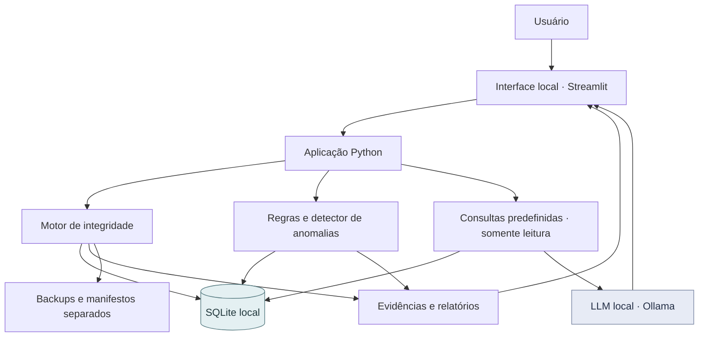
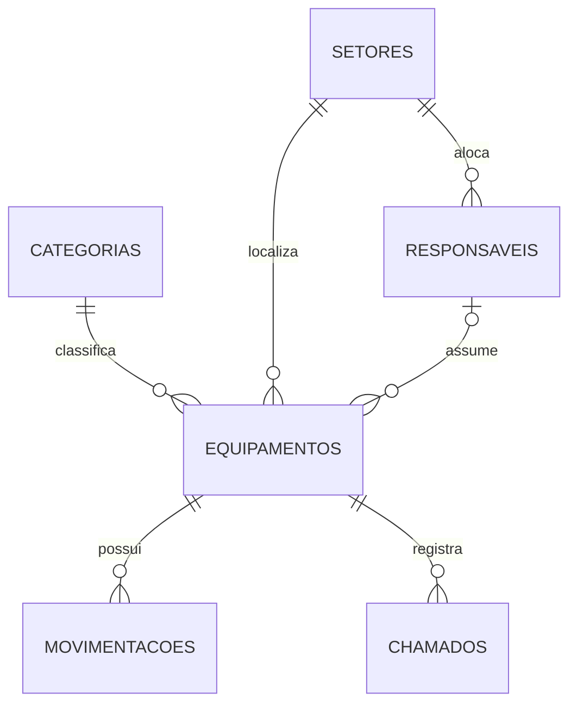

# DataGuard AI

**Local Database Integrity Auditing & AI-Assisted Anomaly Detection**

Projeto experimental em Python para auditar a integridade de dados, detectar anomalias e consultar um banco SQLite em linguagem natural — **sem APIs externas de IA**.

> **Status: dataset sintético disponível; implementação da aplicação planejada.** Os diagramas e módulos abaixo mostram a arquitetura pretendida, não funcionalidades já implementadas.

## Visão geral

O DataGuard AI combina três abordagens **complementares**:

| Camada | Responsabilidade | Tecnologia planejada |
| --- | --- | --- |
| **Integridade** | Restrições, transações, consistência, rastreabilidade e backups | SQLite, Python, SHA-256, HMAC |
| **Detecção** | Identificar inconsistências por regras e anomalias estatísticas | SQL, pandas, scikit-learn |
| **Assistente** | Explicar achados e responder perguntas baseadas em consultas autorizadas | Ollama + modelo de linguagem local |
| **Interface** | Visualizar registros, alertas, evidências e relatórios | Streamlit, Plotly |

### Arquitetura proposta

**Princípio de projeto:** as verificações programáticas determinam os resultados técnicos. O modelo de IA explica os achados, mas não é autorizado a alterar o banco nem a declarar integridade por conta própria.

## Dataset sintético — já disponível

A pasta [`data/`](data/) contém arquivos CSV de um inventário fictício de TI, que servirão de matéria-prima para construir o SQLite nas primeiras etapas.

| Arquivo | Registros | Conteúdo |
| --- | ---: | --- |
| [`categorias.csv`](data/csv/categorias.csv) | 12 | Tipos de equipamentos e valores de referência |
| [`setores.csv`](data/csv/setores.csv) | 18 | Setores e unidades fictícios |
| [`responsaveis.csv`](data/csv/responsaveis.csv) | 90 | Identificadores inteiramente sintéticos |
| [`equipamentos.csv`](data/csv/equipamentos.csv) | 750 | Patrimônio, aquisição, garantia, custo, estado |
| [`movimentacoes.csv`](data/csv/movimentacoes.csv) | 2.095 | Histórico de transferências e movimentações |
| [`chamados.csv`](data/csv/chamados.csv) | 1.196 | Histórico de chamados e reparos |
| **Total** | **4.161** | **6 conjuntos de registros** |

Há **50 anomalias intencionais** em sete categorias. O arquivo [`data/ground_truth/gabarito_anomalias.csv`](data/ground_truth/gabarito_anomalias.csv) registra os casos conhecidos para avaliação; **não deve ser utilizado como entrada do detector**.

**Nota:** os CSVs são os dados de origem versionados. O arquivo SQLite final será **gerado localmente** durante a implementação; não há um arquivo `.db` versionado neste repositório.

## Roteiro de implementação

Comece pelo [**guia de desenvolvimento em `docs/`**](docs/README.md). Cada etapa contém tarefas concretas, artefatos previstos e critérios para validar a conclusão antes de avançar.

| Etapa | Objetivo | Guia |
| --- | --- | --- |
| 0 | Arquitetura, limites e segurança | [00 — Arquitetura](docs/00-arquitetura-e-escopo.md) |
| 1 | Ambiente, esquema e importação dos CSVs | [01 — Preparar o banco](docs/01-ambiente-e-banco.md) |
| 2 | Restrições, transações e verificações | [02 — Integridade](docs/02-integridade-e-transacoes.md) |
| 3 | Auditoria criptográfica e backups | [03 — Evidências e backups](docs/03-auditoria-e-backups.md) |
| 4 | Detecção automática de anomalias | [04 — Anomalias e ML](docs/04-anomalias-e-ml.md) |
| 5 | Consultas em português com IA local | [05 — Assistente offline](docs/05-assistente-local.md) |
| 6 | Dashboard e exportações | [06 — Interface](docs/06-interface-e-relatorios.md) |
| 7 | Testes e avaliação reprodutível | [07 — Testes](docs/07-testes-e-experimentos.md) |
| **8 (futura)** | **Rede privada, PostgreSQL, controle de acesso e prevenção de vazamentos** | [08 — Arquitetura de rede e segurança](docs/08-arquitetura-de-rede-e-seguranca.md) |

A **etapa 08 é opcional e posterior à conclusão do MVP**. Ela inclui um segundo cenário de arquitetura, com redes privadas, PostgreSQL, papéis de usuário, TLS, firewall, auditoria de acessos e testes de segurança. Não é uma funcionalidade já implementada.

## Stack planejada

| Item | Escolha inicial |
| --- | --- |
| Linguagem | Python 3.11+ |
| Banco | SQLite / `sqlite3` |
| Interface | Streamlit |
| Análise | pandas, NumPy |
| Detecção de anomalias | scikit-learn / Isolation Forest |
| LLM local | Ollama e modelo compacto quantizado |
| Gráficos | Plotly |
| Testes | pytest |

**Ambiente de referência:** Windows 11, RTX 3060 Laptop com 6 GB de VRAM e 16 GB de RAM. A escolha final do modelo dependerá de testes reais de memória e latência.

## Integridade ≠ confidencialidade

Executar um LLM local reduz a necessidade de enviar dados a terceiros, mas **não garante a integridade do banco**. Essa propriedade exige controles distintos: restrições do esquema, validação de regras, transações, backups consistentes e evidências independentes. Hashes só revelam alterações em relação a uma **referência confiável**. Nem SHA-256 nem HMAC impedem uma modificação por si mesmos.

## Reproduzibilidade

- Dataset **100% fictício**: nenhuma informação pessoal real.
- Semente de geração registrada em [`data/dataset_info.json`](data/dataset_info.json).
- A **data de referência** do dataset é **13/10/2026**; testes de datas devem usar essa referência, não a data atual da máquina.
- O gabarito deve ser usado **apenas na avaliação** dos detectores.
- Código, modelo, regras, métricas e screenshots serão adicionados gradualmente, conforme as etapas forem implementadas.

> Este projeto está em desenvolvimento. A presença de um item no roadmap não significa que a funcionalidade exista no código.
