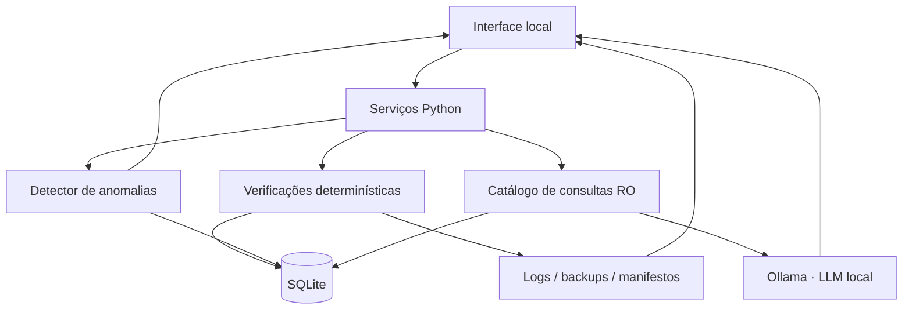

# 00 — Arquitetura, escopo e decisões

**Objetivo:** definir claramente o que o DataGuard AI deve fazer, quais dados serão usados e como evitar que a IA se torne um risco para a base auditada.

**Pré-requisito:** nenhum. **Não implementar código nesta etapa.**

## 1. O problema que o projeto resolve

A aplicação deverá receber um banco local, executar verificações reproduzíveis, apontar inconsistências e explicar resultados em português. O conjunto inicial retrata um inventário **inteiramente fictício**.

Separar quatro conceitos:

| Conceito | Pergunta | Como verificar |
| --- | --- | --- |
| Integridade estrutural | O arquivo SQLite e suas páginas estão consistentes? | `PRAGMA integrity_check` |
| Integridade referencial | Existem referências para registros inexistentes? | `PRAGMA foreign_key_check` |
| Regras de negócio | Existem datas, estados ou operações logicamente incoerentes? | Consultas SQL/Python |
| Anomalia estatística | Algo é incomum em relação aos demais registros? | Estatísticas e ML |

**Integridade criptográfica** é outra dimensão: validar que uma cópia ou evidência não mudou **desde uma referência confiável**. Isso não prova que seu conteúdo era correto quando a referência foi criada.

## 2. Escopo inicial e limites

**Fazer:**
- Banco SQLite local gerado a partir dos seis CSVs versionados.
- Verificador de constraints, PRAGMAs, transações e regras de domínio.
- Trilha de eventos, backups e hashes com referências separadas.
- Detecção de padrões incomuns; primeiro com regras, depois com Isolation Forest.
- Assistente com perguntas em português e **consultas previamente autorizadas**.
- Dashboard, relatório exportável e experimentos reprodutíveis.

**Não fazer agora:**
- Login, cloud, múltiplos usuários, dados empresariais reais.
- Treinar LLM, criar endpoints públicos ou permitir edição pelo assistente.
- Permitir SQL livre ou restauração destrutiva com um clique.
- Considerar todo alerta como fraude, erro ou corrupção confirmada.

## 3. Princípios de arquitetura

1. **O banco é a fonte de fatos; o LLM não é.**
2. **Leitura e escrita são serviços distintos.** A interface de perguntas não ganha credenciais de escrita.
3. **Confirmação, suspeita e explicação são saídas diferentes.**
4. **Os dados de teste precisam permanecer auditáveis.** Gabarito separado e semente fixa.
5. **A aplicação funciona offline após o preparo.** Não enviar prompts nem arquivos a provedores externos.
6. **Toda ação relevante produz um resultado testável.**

## 4. Modelo de dados existente

Os arquivos reais de origem são:

| Tabela futura | Arquivo | Chaves ou relacionamentos |
| --- | --- | --- |
| `categorias` | `data/csv/categorias.csv` | `id`, `nome`, `vida_util_meses`, `valor_referencia_centavos` |
| `setores` | `data/csv/setores.csv` | `id`, `codigo`, `nome`, `unidade` |
| `responsaveis` | `data/csv/responsaveis.csv` | `id`, `identificador_ficticio`, `setor_id` → setores |
| `equipamentos` | `data/csv/equipamentos.csv` | `id`, `patrimonio`, `numero_serie`, `categoria_id`, `responsavel_id`, `setor_id`, datas, custo, status |
| `movimentacoes` | `data/csv/movimentacoes.csv` | `id`, `equipamento_id`, `ocorrido_em`, `setor_origem_id`, `setor_destino_id`, `tipo`, `observacao` |
| `chamados` | `data/csv/chamados.csv` | `id`, `equipamento_id`, datas, prioridade, tipo, status, custo, descrição |

**Datas de referência:** usar **2026-10-13** nas regras de tempo. Não usar `date.today()` para avaliar as anomalias originais: isso altera as respostas ao longo dos anos.

Há **50 anomalias propositalmente inseridas**, descritas apenas no gabarito de avaliação. São anomalias **sem violar as constraints básicas**: o esquema não deve proibir todas as situações que o detector precisa identificar.

## 5. Modelo de ameaças simplificado

| Risco | Mitigação planejada | Limitação |
| --- | --- | --- |
| Registros inválidos | Constraints, transações e checagens de domínio | Não capturam todas as incoerências semânticas |
| Alteração de arquivos de backup | SHA-256 + referência confiável separada | Hash local adulterável junto ao arquivo |
| Manipulação de eventos | HMAC encadeado + âncora e chave fora do banco | Controle total do computador compromete ambos |
| Instruções maliciosas dentro do banco | Separar dados de instruções e limitar ferramentas do LLM | Modelo pode gerar texto enganoso |
| Perguntas que tentam modificar o banco | Catálogo de SELECTs + conexão SQLite de leitura | Nunca confiar só no prompt |
| Exposição de dados | Loopback local, nenhuma nuvem, dados fictícios | Offline não substitui controles de acesso ao PC |

## 6. Decisões a registrar antes de codificar

- [ ] Repositório continua público, com **apenas dados sintéticos**.
- [ ] Pasta de trabalho local: `runtime/`, ignorada no Git.
- [ ] SQLite criado a partir de CSVs, sem versionar um banco operacional.
- [ ] Dataset tem data de referência fixa.
- [ ] Assistente sem operações de escrita e sem SQL arbitrário.
- [ ] O usuário da aplicação confirma manualmente revisões de alertas.
- [ ] Cada execução de auditoria terá identificador e versão das regras.

**Concluído quando:** essas decisões estiverem compreendidas e registradas. Próxima etapa: [01 — Ambiente e banco](01-ambiente-e-banco.md).
