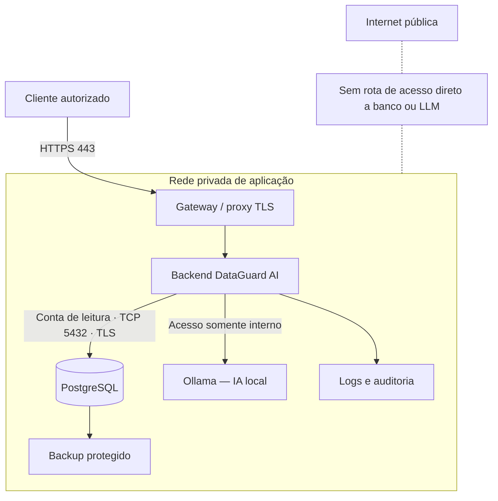

# 08 — Arquitetura de rede privada e segurança corporativa

> **EXPANSÃO FUTURA.** Implementar esta etapa **somente após concluir e testar as etapas 00–07** do DataGuard AI. Este documento descreve um laboratório proposto, não recursos já existentes.
>
> **Propósito:** demonstrar como uma empresa pode usar IA local para consultar e analisar um banco em rede privada, reduzindo o risco de vazamento por exposição de serviços, permissões inadequadas, logs ou respostas do modelo.

## 1. O que vamos demonstrar

O projeto existente audita um inventário fictício em SQLite. Nesta expansão ele se torna uma demonstração controlada de arquitetura **cliente–aplicação–banco–LLM**, com redes privadas e controles verificáveis.

| Propriedade | Objetivo verificável |
| --- | --- |
| Confidencialidade | Usuários e serviços só acessam os dados permitidos |
| Integridade | Consultas da IA não alteram a base; auditoria e backups continuam válidos |
| Disponibilidade | Falhas de serviços têm tratamento claro; recuperação testada |
| Rastreabilidade | Registrar acesso concedido ou negado, sem registrar dados sensíveis desnecessariamente |
| Isolamento | PostgreSQL e Ollama não ficam expostos diretamente ao usuário nem à internet |
| Independência de nuvem | Após preparação, inferência e consultas funcionam sem serviços externos |

**Não confundir:** banco na rede privada não é, por si só, seguro. IA local não impede exfiltração via logs, downloads, erros de autenticação, plugins, relatórios ou máquina comprometida. O objetivo é **testar controles específicos**, não prometer segurança absoluta.

## 2. Topologia de referência

O diagrama é **lógico**, não uma prova de isolamento. O firewall do host, os bind addresses, as regras da rede virtual e as políticas de acesso serão testados separadamente.

### Matriz inicial de comunicação

| Origem | Destino | Protocolo/porta exemplo | Política |
| --- | --- | --- | --- |
| Cliente autorizado | Gateway | HTTPS/TCP 443 | Permitir após autenticação |
| Gateway | Backend | Interno, porta configurada | Permitir só gateway |
| Backend | PostgreSQL | TCP 5432 com TLS | Permitir só backend/conta dedicada |
| Backend | Ollama | HTTP interno 11434, nunca público | Permitir só backend |
| Processo de backup | Destino protegido | Conforme serviço | Permitir somente serviço autorizado |
| Cliente | PostgreSQL / Ollama | Qualquer | **Bloquear** |
| Internet | Serviços do laboratório | Qualquer | **Bloquear** |
| Backend / Ollama | Internet (durante teste offline) | Saída não aprovada | **Bloquear** e verificar |

**Usar TLS quando serviços atravessarem hosts/redes distintas.** Para um laboratório de um computador, pode-se começar com loopback e uma rede virtual privada, sem simular TLS de forma enganosa. Contêineres na mesma máquina não são uma fronteira absoluta de segurança.

## 3. Condições antes de iniciar a expansão

- [ ] Etapas 00–07 concluídas, ou suas limitações documentadas.
- [ ] Auditorias determinísticas executam independentemente do LLM.
- [ ] O catálogo de consultas em leitura está funcional e testado.
- [ ] Backups e a restauração em destino temporário funcionam.
- [ ] Dataset continua **100% sintético**; não importar bancos reais.
- [ ] Testes não dependem do gabarito das 50 anomalias durante a inferência.
- [ ] Fazer um baseline com SQLite para comparar custo e latência depois.

### Hardware e isolamento do laboratório

O notebook de referência tem **16 GB de RAM e RTX 3060 Laptop 6 GB de VRAM**. Prefira, inicialmente, **um único host Windows 11**, com serviços isolados por processos, Docker/WSL2 ou VM, e um modelo pequeno quantizado. Isso permite estudar portas e comunicação sem necessitar de dois computadores físicos.

**Importante:** em Docker Compose, publicar `5432:5432` ou `11434:11434` sem endereço explícito pode expor as portas em interfaces do host. Para teste apenas no host, prefira bind em `127.0.0.1` quando for necessário publicar uma porta. Para comunicação entre serviços no Compose, prefira rede interna com nomes de serviços e sem publicação dessas portas. Verifique a exposição efetiva do Windows/WSL/Docker, não apenas o arquivo de configuração.

## 4. Plano de implementação, em partes

### 08.1 — Mapear o tráfego do projeto atual

**Objetivo:** descobrir quais serviços se comunicam e quais portas realmente escutam.

Tarefas:
1. Inventariar processos: Streamlit/backend, Ollama e SQLite.
2. Registrar portas, protocolos, endereços de bind e fluxos autorizados.
3. Verificar se o endpoint do Ollama é acessível apenas pelo processo previsto.
4. Criar o primeiro diagrama de fluxo e uma tabela de riscos.
5. Registrar resultado de checagem com ferramenta local (`Get-NetTCPConnection`, `netstat` ou equivalente).

**Arquivos futuros:** `docs/network/service-inventory.md`, `docs/network/threat-model.md`, `tests/security/test_service_exposure.py`.

**Aceite:** todos os listeners estão documentados; nenhuma porta desnecessária fica exposta à LAN.

### 08.2 — Separar serviços e criar rede privada de laboratório

**Objetivo:** manter a interface como única porta de entrada autorizada.

Tarefas:
1. Adicionar ambiente de desenvolvimento isolado (`compose.yaml` opcional, sem alterar o funcionamento do MVP).
2. Separar `backend`, `postgres` e, quando viável, `ollama`; Ollama pode continuar no host durante testes de GPU.
3. Definir redes com acesso mínimo, sem `network_mode: host` por padrão.
4. Restringir PostgreSQL e Ollama aos consumidores internos.
5. Testar conexões positivas e negativas a partir de serviços permitidos e não permitidos.
6. Escrever regra explícita de saída para o teste offline e validar sua aplicação no ambiente real.

**Arquivos futuros:** `deploy/lab/compose.yaml`, `deploy/lab/.env.example`, `tests/security/test_network_boundaries.py`.

**Aceite:** o frontend/backend autorizado consulta o serviço necessário; um cliente não autorizado não conecta diretamente ao banco nem ao LLM. A ausência de exposição é verificada no **host e na rede**, não só por nomes de serviço.

### 08.3 — Migrar o laboratório para PostgreSQL

**Objetivo:** estudar o modelo cliente-servidor sem abandonar o SQLite original.

Tarefas:
1. Preservar o banco SQLite do MVP e seus testes.
2. Criar migrations SQL específicas para PostgreSQL usando os mesmos seis CSVs sintéticos.
3. Validar `PRIMARY KEY`, `FOREIGN KEY`, `CHECK`, `UNIQUE`, constraints e índices adequados.
4. Importar tabelas em ordem e verificar contagens esperadas: **12, 18, 90, 750, 2.095, 1.196**.
5. Comparar consultas equivalentes entre SQLite e PostgreSQL, inclusive casos de anomalias.
6. Configurar `listen_addresses`, `pg_hba.conf`, TLS e credenciais restritas, conforme topologia adotada.
7. Criar conta da aplicação com o mínimo de privilégios; não usar superusuário no backend.

**Arquivos futuros:** `src/dataguard/db/postgres/`, `scripts/import_to_postgres.py`, `tests/integration/test_postgres.py`.

**Aceite:** contagens e regras produzem resultados equivalentes; acesso negado fora das origens/contas autorizadas; a conta de consulta não consegue executar escrita.

### 08.4 — Implementar identidades, papéis e controle de acesso

**Objetivo:** permitir perguntas sobre o banco sem disponibilizar todas as linhas para todos os usuários.

Criar identidades **fictícias**, com três papéis exemplares:

| Papel | Pode fazer | Não pode fazer |
| --- | --- | --- |
| Operador | Consultar inventário do setor autorizado | Ver setores de terceiros e administrar usuários |
| Auditor | Ver resultados de auditoria e evidências conforme política | Alterar dados da operação |
| Administrador de laboratório | Configurar controles, aprovar manutenção | Contornar logging sem evidência |

Implementar autenticação no backend, sessões protegidas e **autorização no servidor a cada consulta**. A interface não é o local confiável para aplicar permissões. Para escopo por setor, avaliar **Row-Level Security (RLS)** do PostgreSQL com política explícita e testes, evitando papéis com `BYPASSRLS`, superusuários e exceções indevidas do proprietário da tabela.

**Não basta esconder botões ou instruir o LLM a não responder.** O serviço de consulta deve filtrar os dados antes de enviá-los à IA.

**Arquivos futuros:** `src/dataguard/security/auth.py`, `policy.py`, `migrations/rls/`, `tests/security/test_authorization.py`.

**Aceite:** um usuário restrito não obtém linhas de outro setor, mesmo alterando URL, filtros, IDs ou o texto do prompt.

### 08.5 — Criptografar comunicação e proteger credenciais

**Objetivo:** evitar exposição em trânsito e diminuir o impacto de comprometimento de uma conta.

1. Adicionar HTTPS/TLS válido ao gateway; testar falha quando o certificado/host não é confiável.
2. Usar TLS com verificação de certificado na conexão PostgreSQL quando houver tráfego entre hosts; não adotar `sslmode=require` como equivalente a validação completa de identidade. Preferir `verify-full` onde apropriado.
3. Não expor HTTP interno do Ollama fora da zona protegida; se atravessar fronteiras de rede, envolver a comunicação em canal protegido e autenticado.
4. Manter credenciais fora do código e do Git; usar armazenamento de segredos apropriado ao ambiente e `.env.example` apenas com **placeholders**.
5. Separar identidades e segredos do app, backups e serviços de auditoria.
6. Aplicar tempo limite, limites de tamanho, redução de dados em logs e política de atualização.

**Aceite:** falhas de certificado são rejeitadas; segredos não aparecem em commits, mensagens de erro ou logs; serviços não aceitam acesso anônimo fora da zona prevista.

### 08.6 — Prevenir vazamento por perguntas e respostas

**Objetivo:** impedir que o LLM e a interface sejam atalhos para obter dados não autorizados.

1. Preservar o catálogo de **consultas SQL predefinidas e parametrizadas** da etapa 05.
2. Associar cada requisição a uma identidade autenticada e política de escopo.
3. Limitar linhas, paginação, campos sensíveis, frequência e duração de consultas.
4. **Filtrar e minimizar os dados antes de enviá-los ao modelo.** O LLM recebe apenas resultados que o usuário pode ver.
5. Tratar campos do banco e documentos como dados não confiáveis (**prompt injection**), sem permissões de ferramenta.
6. Não registrar prompts ou respostas completos contendo informações restritas por padrão; aplicar política explícita de retenção.
7. Aplicar a mesma autorização nas exportações CSV/PDF, endpoints de consulta, relatórios e mensagens de erro.
8. Testar consultas com tentativa de trocar de perfil, setor, ID e instruções para ignorar regras.

**Aceite:** respostas, tabelas, exports, logs e mensagens de erro não exibem dados fora do escopo; tentativas maliciosas não provocam `UPDATE`, `DELETE` ou acesso a outros setores.

### 08.7 — Logs, firewall, auditoria e backups

**Objetivo:** observar tentativas de acesso sem criar um novo repositório de informações sensíveis.

- Registrar `timestamp_utc`, identidade pseudônima/ID, tipo de operação, recurso, resultado (permitido/negado), ID de requisição e origem de rede quando necessário.
- Evitar registrar credenciais, conteúdo integral de campos, prompts confidenciais ou documentos completos.
- Validar as regras do firewall com tentativas autorizadas em **ambiente próprio de testes**, sem varredura de redes de terceiros.
- Conservar auditoria de consultas em destino com controle de acesso e retenção definidos.
- Separar operação de backup da conta de consulta; praticar restauração em ambiente isolado.
- Incluir regras de detecção para tentativas repetidas de autenticação e consultas proibidas.

**Aceite:** ações autorizadas e negadas geram eventos verificáveis; os logs não incluem material confidencial desnecessário; restaurar backup não sobrescreve banco de produção no laboratório.

### 08.8 — Comparar as arquiteturas e finalizar a documentação

Executar a mesma bateria de consultas sintéticas em:

**Cenário A: single-host** — SQLite + Ollama local (etapas 00–07).

**Cenário B: serviços privados** — backend + PostgreSQL + Ollama em rede virtual privada, com permissões explícitas.

Medir:
- Latência mediana/p95 por consulta, auditoria e geração de resposta.
- RAM/VRAM consumidas, duração dos benchmarks e configuração de hardware.
- Portas e interfaces expostas antes/depois da configuração.
- Quantidade de testes de autorização positiva/negativa aprovados.
- Bloqueio de escrita pelo assistente e de leitura fora do perfil.
- Resultado de tentativas controladas de exfiltração via prompt, exportação e logs.
- Capacidade de operação offline **depois** de provisionar pacotes/modelos.

**Aceite:** apresentar resultados mensurados, diagramas da rede real implementada, instruções reproduzíveis, limitações e evidências de testes. Não alegar que o cenário B é sempre mais rápido ou mais seguro: separar ganhos de isolamento de custos operacionais.

## 5. Matriz de testes de segurança (laboratório)

| ID | Teste | Resultado esperado |
| --- | --- | --- |
| N01 | Abrir PostgreSQL diretamente do navegador/cliente comum | Porta inacessível; sem exposição pública |
| N02 | Acessar Ollama a partir de cliente não autorizado | Conexão não permitida |
| N03 | Consulta autenticada pelo backend | Permitida apenas dentro da política |
| N04 | Conta de leitura tenta `INSERT`, `UPDATE` ou `DELETE` | Negada no próprio banco |
| N05 | Operador solicita registro de outro setor | Nenhuma linha retornada |
| N06 | Prompt diz "ignore permissões" | Filtros continuam em vigor |
| N07 | Exportação solicita todos os setores | Somente escopo autorizado |
| N08 | Log e resposta de erro em falha de autenticação | Sem vazamento de segredo ou payload |
| N09 | TLS apresenta certificado inválido | Conexão rejeitada |
| N10 | Desligar acesso externo após preparar dependências | Inferência e consultas seguem operacionais |
| N11 | Processo de app falha no meio de uma consulta | Sem escrita parcial e falha registrada |
| N12 | Restore de backup em destino temporário | Hash validado e banco restaurado conferido |

**Resultados devem ser observados, não presumidos.** Capturar configuração, horário de teste, comando executado e evidência de negação/sucesso, ocultando segredos.

## 6. Ordem de branches e entregas

| Etapa | Branch sugerida | Entrega |
| --- | --- | --- |
| 08.1 | `feat/network-inventory` | Inventário de serviços, portas e ameaças |
| 08.2 | `feat/private-network-lab` | Rede de laboratório e restrições de conectividade |
| 08.3 | `feat/postgres-lab` | Migração reproduzível para PostgreSQL |
| 08.4 | `feat/access-control` | RBAC/RLS e testes de autorização |
| 08.5 | `feat/transport-security` | TLS e proteção de credenciais |
| 08.6 | `feat/data-leak-prevention` | Políticas para prompts, resultados e exports |
| 08.7 | `feat/security-audit` | Logs, bloqueios e backups |
| 08.8 | `research/architecture-comparison` | Métricas, diagramas e relatório comparativo |

## 7. Critério final de conclusão

- [ ] O MVP original segue funcionando sem a infraestrutura distribuída.
- [ ] O banco e o Ollama não são acessíveis diretamente por clientes da LAN/internet.
- [ ] Todos os usuários do laboratório são fictícios e têm permissões testáveis.
- [ ] A autorização ocorre no backend/banco, **não apenas no prompt**.
- [ ] A IA não pode executar operações de escrita ou consultas arbitrárias.
- [ ] Conexões entre hosts são autenticadas e criptografadas.
- [ ] Logs e exportações respeitam a política de acesso.
- [ ] Testes negativos e positivos possuem evidências.
- [ ] A comparação SQLite local × PostgreSQL privado é reproduzível.
- [ ] Nada com segredo ou dados pessoais reais foi enviado ao GitHub.

## 8. Referências para consulta na implementação

- [PostgreSQL — Client Authentication](https://www.postgresql.org/docs/current/client-authentication.html)
- [PostgreSQL — Row Security Policies](https://www.postgresql.org/docs/current/ddl-rowsecurity.html)
- [PostgreSQL — SSL Support](https://www.postgresql.org/docs/current/ssl-tcp.html)
- [Docker — Publishing and exposing ports](https://docs.docker.com/get-started/docker-concepts/running-containers/publishing-ports/)
- [OWASP — Top 10 for LLM Applications](https://genai.owasp.org/llm-top-10/)
- [NIST — Zero Trust Architecture, SP 800-207](https://csrc.nist.gov/pubs/sp/800/207/final)

---

**Voltar para [o roteiro principal](README.md)** · **[README do projeto](../README.md)**
