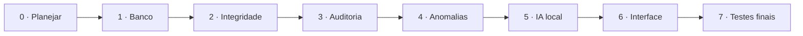

# Guia de desenvolvimento — DataGuard AI

Este é o **ponto de partida** para construir o DataGuard AI em partes, sem tentar implementar toda a aplicação de uma vez.

**Situação atual:** os **seis CSVs sintéticos** e o **gabarito separado** estão disponíveis em `data/`. A aplicação Python, o esquema SQLite, os verificadores, a interface e a IA **ainda serão implementados**.

## Sequência recomendada



| Ordem | Documento | Entrega verificável |
| --- | --- | --- |
| 0 | [Arquitetura e escopo](00-arquitetura-e-escopo.md) | Limites e responsabilidades decididos |
| 1 | [Ambiente e banco](01-ambiente-e-banco.md) | SQLite gerado dos CSVs e relações conferidas |
| 2 | [Integridade e transações](02-integridade-e-transacoes.md) | Verificador com testes de falha e rollback |
| 3 | [Auditoria e backups](03-auditoria-e-backups.md) | Evidências verificáveis e restauração testada |
| 4 | [Anomalias e Machine Learning](04-anomalias-e-ml.md) | Alertas com evidências, baseline e comparação |
| 5 | [Assistente local](05-assistente-local.md) | Perguntas em português com consulta somente leitura |
| 6 | [Interface e relatórios](06-interface-e-relatorios.md) | Painel navegável e exportação |
| 7 | [Testes e experimentos](07-testes-e-experimentos.md) | Resultados reproduzíveis e teste offline |

## Como estudar e implementar cada etapa

1. Leia **somente o documento da etapa atual**.
2. Crie os arquivos que ele especifica, sem antecipar módulos de fases posteriores.
3. Escreva testes para o comportamento principal (inclusive casos de falha).
4. Execute os testes e compare com os **critérios de aceite** do documento.
5. Registre limitações e pequenas decisões no commit ou nas anotações da etapa.
6. Só avance quando a etapa funcionar isoladamente.

### Padrão de trabalho sugerido

- Um branch por etapa, como `feat/01-sqlite-dataset` e `feat/02-integrity`.
- Commits pequenos, com nomes objetivos (`feat:`, `test:`, `docs:`, `fix:`).
- A aplicação nunca deve carregar o `gabarito_anomalias.csv` na execução normal.
- Nunca enviar bancos reais, chaves, `.env`, checkpoints grandes, backups ou logs com dados privados para o GitHub.
- Se uma etapa exigir mudar o esquema, documente uma migration em vez de substituir o banco silenciosamente.

## Estrutura prevista ao longo do desenvolvimento

```text
dataguard-ai-/
├── README.md
├── docs/                         # Guias de implementação (esta pasta)
├── data/
│   ├── csv/                      # Dados sintéticos, já versionados
│   ├── ground_truth/             # Gabarito para avaliação, já versionado
│   └── dataset_info.json
├── src/dataguard/                # A criar na etapa 1
│   ├── db/
│   ├── integrity/
│   ├── audit/
│   ├── detection/
│   ├── assistant/
│   └── reports/
├── tests/                        # A criar na etapa 1
├── scripts/                      # A criar conforme necessário
├── runtime/                      # A criar localmente; ignorar no Git
│   ├── databases/
│   ├── backups/
│   └── reports/
├── app.py                        # A criar na etapa 6
├── pyproject.toml                # A criar na etapa 1
└── .gitignore                    # A criar na etapa 1
```

**Nota:** a estrutura acima é **planejada**; não indica que os arquivos de código já existem.

## Primeira tarefa

Abra [**01 — Ambiente e banco**](01-ambiente-e-banco.md). O objetivo inicial é conseguir importar os seis CSVs, criar o SQLite e consultar contagens/relações corretamente, **sem IA e sem interface gráfica**.

Depois disso, a etapa 2 ensinará a diferenciar erro de estrutura, violação de regras de negócio e anomalia estatística.

## Regra geral de qualidade

Para cada funcionalidade, registre:

| Pergunta | Exemplo |
| --- | --- |
| Qual é a entrada? | Arquivo CSV, evento ou pergunta |
| Qual é a saída? | Consulta, resultado, alerta ou relatório |
| O que pode falhar? | FK inválida, backup adulterado, consulta proibida |
| Como provar que funciona? | Teste reproduzível com resultado esperado |
| Qual é o limite? | Um score estatístico **não prova fraude** |

Voltar ao [README principal](../README.md).
