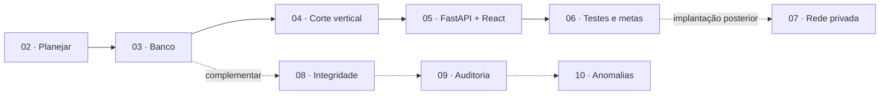

# Guia de desenvolvimento — DataGuard AI

Este é o **ponto de partida** para construir o DataGuard AI em partes. O objetivo principal é validar os **controles de segurança** de uma IA local que consulta dados empresariais: autorização por papel, catálogo de consultas somente leitura, minimização, resistência a prompt injection e operação sem inferência externa. O inventário sintético é apenas o caso de teste.

**Situação atual:**
- **Disponível:** dataset sintético **v2** validado ([`scripts/dataset/`](../scripts/dataset/README.md)), conjunto de perguntas de avaliação e protótipo visual React testado.
- **A implementar:** banco SQLite operacional, serviços Python, API FastAPI, autorização e integração com o Ollama.

**Regra transversal:** os requisitos de rede, egress, identidade, autorização e confidencialidade são definidos na etapa 02 e verificados em cada etapa. A etapa 07 executa a **implantação empresarial**; ela não inaugura o planejamento de segurança.

## Duas trilhas



**Trilha principal (segurança da IA local):** 02 → 03 → 04 → 05 → 06 → 07. Logo após a etapa 03, o **corte vertical** da etapa 04 exercita de ponta a ponta a hipótese central:

> pergunta → papel fictício → intenção do catálogo → SQL parametrizado em conexão somente leitura → resultado limitado → Ollama local redige a explicação.

Isso valida cedo o hardware, a qualidade do modelo em português e os controles de acesso, antes de investir na interface.

**Trilha complementar (qualidade dos dados):** 08 → 09 → 10. São análises úteis sobre os dados (integridade, evidências, anomalias) que podem ser feitas em paralelo ou depois, sem bloquear a trilha principal. O assistente só usa resultados dessa trilha (por exemplo, a intenção `resumo_alertas`) quando ela existir.

| Etapa | Trilha | Documento | Entrega verificável |
| --- | --- | --- | --- |
| 00 | Referência | [Stack e decisões de software](software/00-stack-e-decisoes-de-software.md) | Alternativas, riscos, versões e candidatos a modelo registrados |
| 01 | Referência | [Dimensionamento de hardware](hardware/README.md) | Hardware do MVP à empresa, com o que medir antes de comprar |
| 02 | Principal | [Arquitetura e escopo](software/02-arquitetura-e-escopo.md) | Limites, ameaças e decisões registrados |
| 03 | Principal | [Ambiente e banco](software/03-ambiente-e-banco.md) | SQLite gerado dos CSVs validados; relações conferidas |
| 04 | Principal | [Assistente local](software/04-assistente-local.md) | Corte vertical com papéis, catálogo somente leitura e Ollama |
| 05 | Principal | [Interface e relatórios](software/05-interface-e-relatorios.md) | API FastAPI e protótipo React conectado, local e offline |
| 06 | Principal | [Testes e experimentos](software/06-testes-e-experimentos.md) | Metas numéricas medidas e teste offline |
| 07 | Implantação posterior | [Rede e segurança](software/07-arquitetura-de-rede-e-seguranca.md) | Rede privada, PostgreSQL/RLS, identidade e testes de vazamento |
| 08 | Complementar | [Integridade e transações](software/08-integridade-e-transacoes.md) | Verificador com testes de falha e rollback |
| 09 | Complementar | [Auditoria e backups](software/09-auditoria-e-backups.md) | Evidências verificáveis e restauração testada |
| 10 | Complementar | [Anomalias e ML](software/10-anomalias-e-ml.md) | Alertas com evidências; ML exploratório |

> **Numeração alterada em 14/10/2026.** Os documentos de referência passaram a abrir a sequência (00 e 01) e as etapas foram renumeradas na ordem de leitura. Equivalência com a **numeração original**: arquitetura 00 → **02**, banco 01 → **03**, assistente 05 → **04**, interface 06 → **05**, testes 07 → **06**, rede 08 → **07**, integridade 02 → **08**, auditoria 03 → **09**, anomalias 04 → **10**. Os arquivos foram renomeados de acordo e, depois, separados nas pastas `hardware/` e `software/`; se você tem links ou anotações antigos, use esta tabela.

**Organização das pastas:**

| Pasta | Conteúdo |
| --- | --- |
| [`hardware/`](hardware/README.md) | Dimensionamento de hardware: notebook do MVP, piloto, departamento e empresa |
| [`software/`](software/00-stack-e-decisoes-de-software.md) | Stack e decisões de software, etapas 02–10 e guias por tela em [`software/interface/`](software/interface/README.md) |

A numeração é única e continua a mesma (00–10), independentemente da pasta; só os caminhos mudaram.

**Referência (00 e 01):** não são etapas de implementação. [Stack e decisões de software](software/00-stack-e-decisoes-de-software.md) registra por que cada tecnologia foi escolhida, as alternativas, os riscos e as versões; [Dimensionamento de hardware](hardware/README.md) dimensiona o MVP no notebook e as escalas maiores.

## Stack e situação

| Camada | Tecnologia | Situação |
| --- | --- | --- |
| Frontend | React 18 + TypeScript + Vite 6 | **Implementado** (protótipo visual) |
| Estilo e componentes | Tailwind CSS 4 + padrão shadcn/ui + Lucide React | **Implementado** |
| Tabelas, dados e gráficos | TanStack Table/Query + Recharts | **Implementado** (API simulada local) |
| Scripts do dataset | Python (biblioteca padrão) | **Implementado** |
| Banco | Python + SQLite | Etapa 03 |
| Autorização local | Papéis fictícios aplicados no backend | Etapa 04 |
| IA local e consultas | Python + Ollama | Etapa 04 |
| Backend web | Python + FastAPI + Pydantic | Etapa 05 |
| Qualidade de dados | Python + scikit-learn | Etapas 08–10 (complementar) |
| Servidor de banco em rede privada | PostgreSQL, RLS, TLS, identidade corporativa | Etapa 07 |

**Interface web local não é hospedagem na internet.** Durante o desenvolvimento, Vite e FastAPI usam `127.0.0.1`. Depois do build, o FastAPI servirá os arquivos React. Somente o backend acessa o SQLite e o Ollama.

## Como implementar cada etapa

1. Leia o documento da etapa atual e o trecho correspondente de [stack e decisões de software](software/00-stack-e-decisoes-de-software.md).
2. Crie os arquivos especificados, sem antecipar módulos de fases posteriores.
3. Escreva testes para o comportamento principal, **inclusive casos negados e de falha**.
4. Execute os testes e compare com os **critérios de aceite** e as metas da [etapa 06](software/06-testes-e-experimentos.md).
5. Registre limitações e decisões no commit ou nas anotações da etapa.
6. Só avance quando a etapa funcionar isoladamente.

### Padrão de trabalho sugerido

- Um branch por etapa, como `feat/03-sqlite-dataset` e `feat/04-vertical-slice`.
- Commits pequenos, com prefixos objetivos (`feat:`, `test:`, `docs:`, `fix:`).
- A aplicação nunca carrega `gabarito_anomalias.csv` na execução normal.
- Dependências com versões travadas (`package-lock.json`; `requirements` com hashes quando o backend existir).
- Nunca enviar bancos reais, chaves, `.env`, modelos, backups ou logs privados ao GitHub.
- Mudanças no dataset passam por script revisado, `validar_dataset.py` e regeneração do manifesto. Mudanças no esquema viram migration.

## Estrutura prevista

```text
dataguard-ai/
├── README.md
├── docs/                         # Guias (esta pasta)
│   ├── hardware/                 # Dimensionamento de hardware (01)
│   └── software/                 # Stack e decisões (00), etapas 02–10 e interface/
├── data/
│   ├── csv/                      # Dados sintéticos v2
│   ├── ground_truth/             # Gabarito, somente avaliação
│   ├── avaliacao/                # Perguntas do assistente com respostas esperadas
│   ├── dataset_info.json
│   └── MANIFEST.sha256
├── scripts/dataset/              # Validação e geração (implementado)
├── config/                       # Exemplos sem segredos (implementado)
├── frontend/                     # Protótipo React (implementado)
├── src/dataguard/                # Backend, a partir da etapa 03
│   ├── db/  security/  assistant/  api/  reports/
│   └── integrity/  audit/  detection/   # trilha complementar
├── tests/                        # A partir da etapa 03
├── runtime/                      # Local; ignorado no Git
├── pyproject.toml                # Etapa 03
├── .github/workflows/            # Já existe (CI e publicação da demo)
├── .gitattributes                # Já existe (LF nos dados, para os hashes)
└── .gitignore                    # Já existe
```

## Primeira tarefa

Abra [**03 — Ambiente e banco**](software/03-ambiente-e-banco.md): rode `validar_dataset.py`, importe os seis CSVs, crie o SQLite e confira contagens e relações, **sem IA e sem interface**. Em seguida, vá direto para o corte vertical da [etapa 04](software/04-assistente-local.md).

## Regra geral de qualidade

| Pergunta | Exemplo |
| --- | --- |
| Qual é a entrada? | Arquivo CSV, evento, pergunta, papel do usuário |
| Qual é a saída? | Consulta, resultado, negação, alerta ou relatório |
| O que pode falhar? | FK inválida, consulta fora do escopo, prompt injection, Ollama indisponível |
| Como provar que funciona? | Teste reproduzível com resultado esperado, **inclusive o caso negado** |
| Qual é o limite? | Um score estatístico **não confirma erro**; loopback **não substitui autorização** |

Voltar ao [README principal](../README.md).
