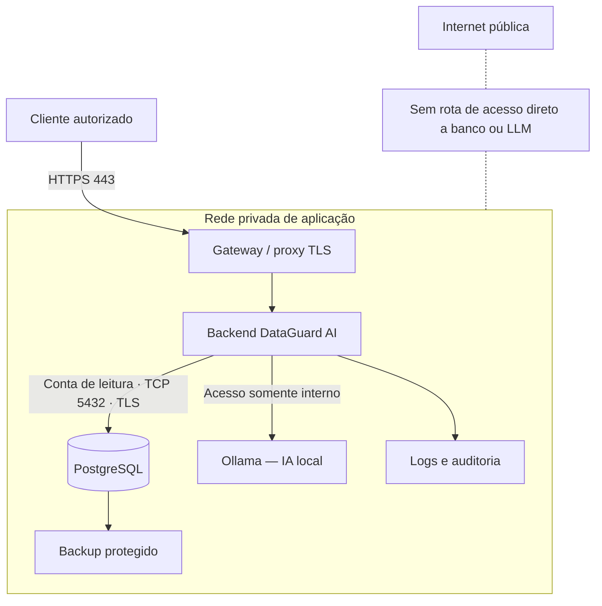

# 07 — Arquitetura de rede privada e segurança corporativa

> **IMPLANTAÇÃO EMPRESARIAL FUTURA.** O laboratório de rede será implementado após validar o protótipo 02–06. **Os requisitos de confidencialidade, ausência de inferência externa, permissões e controle de tráfego devem ser definidos desde a etapa 02 e testados ao longo do MVP.** Este documento descreve uma implantação proposta, não recursos já existentes.
>
> **Propósito:** demonstrar como uma empresa pode usar IA local para consultar e analisar um banco em rede privada, reduzindo o risco de vazamento por exposição de serviços, permissões inadequadas, logs ou respostas do modelo.

## Princípio arquitetural

**Não depender de APIs externas de IA** não significa eliminar APIs internas: o frontend pode comunicar-se com FastAPI, e o backend com Ollama e o SGBD, **exclusivamente nos caminhos autorizados**. Aplicar bloqueio de saída por padrão, autenticação e autorização, segmentação, TLS onde houver comunicação entre hosts, filtragem de dados, auditoria e testes de tráfego. Evitar copiar o banco corporativo inteiro para o serviço de IA.

## 1. O que vamos demonstrar

O objetivo do projeto é uma **solução empresarial de IA privada**; o inventário sintético SQLite é apenas a prova de conceito. Nesta etapa a solução será validada em uma arquitetura controlada **cliente–aplicação–banco–LLM**, com redes privadas e controles verificáveis.

| Propriedade | Objetivo verificável |
| --- | --- |
| Confidencialidade | Usuários e serviços só acessam os dados permitidos |
| Integridade | Consultas da IA não alteram a base; auditoria e backups continuam válidos |
| Disponibilidade | Falhas de serviços têm tratamento claro; recuperação testada |
| Rastreabilidade | Registrar acesso concedido ou negado, sem registrar dados sensíveis desnecessariamente |
| Isolamento | PostgreSQL e Ollama não ficam expostos diretamente ao usuário nem à internet |
| Independência de nuvem | Após preparação, inferência e consultas funcionam sem serviços externos |

**Não confundir:** banco na rede privada não é, por si só, seguro. IA local não impede exfiltração via logs, downloads, erros de autenticação, plugins, relatórios ou máquina comprometida. O objetivo é **testar controles específicos**, não prometer segurança absoluta.

## 2. Topologia de referência

O diagrama é **lógico**, não uma prova de isolamento. O firewall do host, os bind addresses, as regras da rede virtual e as políticas de acesso serão testados separadamente.

### Matriz inicial de comunicação

| Origem | Destino | Protocolo/porta exemplo | Política |
| --- | --- | --- | --- |
| Cliente autorizado | Gateway | HTTPS/TCP 443 | Permitir após autenticação |
| Gateway | Backend | Interno, porta configurada | Permitir só gateway |
| Backend | PostgreSQL | TCP 5432 com TLS | Permitir só backend/conta dedicada |
| Backend | Ollama | HTTP interno 11434, nunca público | Permitir só backend |
| Processo de backup | Destino protegido | Conforme serviço | Permitir somente serviço autorizado |
| Cliente | PostgreSQL / Ollama | Qualquer | **Bloquear** |
| Internet | Serviços do laboratório | Qualquer | **Bloquear** |
| Backend / Ollama | Internet (durante teste offline) | Saída não aprovada | **Bloquear** e verificar |

**Usar TLS quando serviços atravessarem hosts/redes distintas.** Para um laboratório de um computador, pode-se começar com loopback e uma rede virtual privada, sem simular TLS de forma enganosa. Contêineres na mesma máquina não são uma fronteira absoluta de segurança.

### 2.1 — Cenário A: React + FastAPI + Ollama no mesmo Windows (configuração prática)

**Arquitetura escolhida para o projeto:** frontend **React + TypeScript + Vite**, backend **Python + FastAPI**, modelo de IA executado no **Ollama**, banco **SQLite**. Todos executam no mesmo computador Windows 11. O navegador é apenas a interface; **não existe hospedagem externa nem necessidade de publicação na internet**.

**Quando aplicar:** as configurações de rede deste cenário podem ser utilizadas assim que frontend e backend existirem nas etapas do MVP. Esta seção está registrada na etapa 07 para servir como referência; **não é necessário implantar PostgreSQL, contêineres ou uma intranet antes de concluir o MVP**.

~~~mermaid
flowchart TD
    U["Navegador neste notebook"] -->|"127.0.0.1:5173 (desenvolvimento)"| R["React + Vite"]
    R -->|"/api → 127.0.0.1:8000"| F["FastAPI"]
    F -->|"127.0.0.1:11434"| O["Ollama — modelo local"]
    F --> S[("SQLite — arquivo local")]
    F --> A["Auditoria, verificações e relatórios"]
    N["Outra máquina na LAN"] -.- X["Sem porta publicada na LAN"]
    X -.- R
~~~

O endereço **127.0.0.1** designa a própria máquina (*loopback*). Se outro computador acessar seu próprio 127.0.0.1, ele **não** chegará ao notebook que executa o DataGuard AI. **SQLite não possui porta TCP própria:** o programa Python abre um arquivo de banco no disco.

| Serviço | Porta de exemplo | Endereço de escuta no MVP | Quem acessa |
| --- | ---: | --- | --- |
| Vite (somente desenvolvimento) | 5173 | 127.0.0.1 | Navegador do próprio notebook |
| FastAPI | 8000 | 127.0.0.1 | Proxy de desenvolvimento do Vite ou navegador na versão final |
| Ollama | 11434 | 127.0.0.1 | Backend Python; **não** enviar requisições do React direto ao Ollama |
| SQLite | — | Arquivo local | Somente serviços Python autorizados |
| PostgreSQL | 5432 | **Não utilizado no MVP** | Apenas na expansão 07.3 |

**Nota sobre portas:** os números são convenções de desenvolvimento; caso a porta esteja ocupada, corrigir a configuração conscientemente e registrar a mudança. Nunca resolver exposição habilitando escuta em todas as interfaces.

#### A. Configurar o Vite (React + TypeScript)

**Arquivo existente:** `frontend/vite.config.ts` já restringe o Vite a `127.0.0.1` com `strictPort`. Na etapa 05, acrescente o proxy `/api` como no exemplo abaixo (o arquivo real também contém o plugin do Tailwind, o alias `@` e a configuração de testes).

~~~ts
// Restringe o Vite ao loopback e encaminha /api ao FastAPI local
import { defineConfig } from 'vite';
import react from '@vitejs/plugin-react';

export default defineConfig({
  plugins: [react()],
  server: {
    host: '127.0.0.1',
    port: 5173,
    strictPort: true,
    proxy: {
      '/api': {
        target: 'http://127.0.0.1:8000',
        changeOrigin: true,
      },
    },
  },
});
~~~

O frontend deverá chamar caminhos **relativos**, por exemplo **/api/inventory**, **/api/audits** e **/api/chat** (nomes ilustrativos — endpoints ainda a implementar). O prefixo **/api** deve existir também nas rotas FastAPI; se a aplicação usar outra convenção, configurar a reescrita do proxy conscientemente.

Executar no terminal PowerShell, dentro de **frontend/**, após instalar as dependências:

~~~powershell
# Inicia o servidor de desenvolvimento no loopback, sem acesso pela LAN
npm run dev -- --host 127.0.0.1 --port 5173
~~~

Abrir **http://127.0.0.1:5173**. **Não usar** a opção "--host 0.0.0.0", "host: true", "allowedHosts: true" ou CORS irrestrito para tentar consertar um problema de acesso local. O Vite é **servidor de desenvolvimento**, não deve ser disponibilizado na intranet como serviço de produção.

#### B. Configurar o FastAPI

**Exemplo:** comando para projeto com arquivo **main.py** e variável **app** na raiz; caso o backend seja movido para um pacote em **src/dataguard/api/**, adaptar o caminho do módulo.

~~~powershell
# Inicia o FastAPI somente na interface de loopback do Windows
python -m uvicorn main:app --host 127.0.0.1 --port 8000
~~~

Testar **http://127.0.0.1:8000/docs** apenas quando o FastAPI estiver implementado. A documentação interativa não deve ser publicada sem avaliação de autorização na expansão empresarial.

**Autorização:** o FastAPI será o único serviço responsável por autenticar/autorizar solicitações, aplicar filtros de acesso e executar consultas aprovadas. **CORS e loopback não substituem autenticação/autorização nem proteção contra requisições indevidas de páginas maliciosas (CSRF/rebinding).** Evitar liberar origens coringa e nunca confiar apenas em bloquear botões na interface.

#### C. Configurar Ollama no Windows e impedir o uso de nuvem

O Ollama normalmente escuta em **127.0.0.1:11434**. No Windows, a configuração do aplicativo é feita por variáveis de ambiente do usuário e precisa de **reinicialização do aplicativo Ollama** para ser aplicada.

1. Encerrar o Ollama pela bandeja do sistema Windows.
2. Abrir **Configurações do Windows → Editar variáveis de ambiente da conta**.
3. Criar/ajustar as variáveis do usuário com os valores abaixo:

| Variável | Valor para o laboratório local | Motivo |
| --- | --- | --- |
| OLLAMA_HOST | 127.0.0.1:11434 | Vincular o servidor ao loopback |
| OLLAMA_NO_CLOUD | 1 | Desativar as funcionalidades em nuvem do Ollama |

4. Reiniciar o aplicativo Ollama pelo menu Iniciar.
5. Confirmar que a nuvem está desativada: o log do Ollama deve mostrar `Ollama cloud disabled: true`. Alternativa à variável: a chave `disable_ollama_cloud` em `~/.ollama/server.json` ([FAQ do Ollama](https://docs.ollama.com/faq)). Com a nuvem desativada, modelos em nuvem e busca web ficam indisponíveis.
6. Confirmar que o modelo **local** já foi baixado antes de desconectar a internet.

Outra maneira, em PowerShell, **persistindo valores apenas para a conta do Windows** (também requer reiniciar o Ollama):

~~~powershell
# Define bind de loopback e desativa nuvem na configuração do usuário
[Environment]::SetEnvironmentVariable('OLLAMA_HOST', '127.0.0.1:11434', 'User')
[Environment]::SetEnvironmentVariable('OLLAMA_NO_CLOUD', '1', 'User')
~~~

O backend consulta **http://127.0.0.1:11434**, **não** o navegador. Não definir OLLAMA_HOST como **0.0.0.0:11434** neste cenário, não publicar a porta 11434 e não instalar túneis públicos. Quando faltar um modelo, o assistente deverá apresentar erro/fallback local em vez de substituir silenciosamente a inferência por um serviço externo.

#### D. Versão final local: uma só origem no navegador

Depois da criação do frontend, executar o **build** do React e servir os arquivos gerados em **frontend/dist/** pelo FastAPI, usando **StaticFiles** ou equivalente e tratamento apropriado de rotas SPA.

~~~powershell
# Compila o React para arquivos estáticos locais (executar dentro de frontend)
npm run build
~~~

Na distribuição local final, **Vite não precisa ficar em execução**. O usuário abre a interface no navegador pelo **http://127.0.0.1:8000**, com **FastAPI** servindo interface e rotas **/api/** na mesma origem; **Ollama** continua em loopback. Não carregar scripts, CSS, fontes, gráficos ou ícones de CDNs externas em tempo de execução.

### 2.2 — Confirmar a configuração real no Windows 11

Execute os testes **com os serviços já iniciados**. Todos os comandos abaixo são de **consulta**, não criam regras de firewall e não alteram a configuração da máquina.

~~~powershell
# Mostra IP local, porta e processo dos serviços em escuta
Get-NetTCPConnection -State Listen -LocalPort 5173,8000,11434 |
    Select-Object LocalAddress,LocalPort,State,OwningProcess |
    Sort-Object LocalPort
~~~

**Resultado esperado no MVP:** nas portas em funcionamento, **LocalAddress = 127.0.0.1**. Serviços que ainda não foram iniciados não aparecem. Investigar qualquer resultado em **0.0.0.0**, **::** (todas as interfaces IPv6), ou endereço da LAN antes de prosseguir. **::1** também indica loopback IPv6, mas esta documentação configura IPv4 de modo explícito.

~~~powershell
# Verifica a conectividade local das três portas após iniciar seus serviços
Test-NetConnection -ComputerName 127.0.0.1 -Port 5173
Test-NetConnection -ComputerName 127.0.0.1 -Port 8000
Test-NetConnection -ComputerName 127.0.0.1 -Port 11434
~~~

**Resultado esperado:** TcpTestSucceeded = True para cada serviço iniciado. Isso prova apenas conexão **local**, não que o endpoint está autenticado ou que o aplicativo não envia dados externos.

~~~powershell
# Confere a resposta do Ollama e os modelos locais já instalados
Invoke-RestMethod -Uri http://127.0.0.1:11434/api/tags
ollama list
~~~

**Teste de exposição:** em **outro dispositivo seu e autorizado na mesma rede**, tentar acessar o **IP de LAN do notebook** na porta do frontend ou backend durante o MVP; a conexão deve falhar. O teste local em 127.0.0.1 **sozinho não comprova** que não exista outra interface publicada. Revisar também regras do firewall do Windows, configurações de proxy/reverso, WSL2 e Docker se utilizados.

**Teste offline:** após instalar e baixar tudo, desligar o Wi-Fi/conectividade externa, manter os processos locais ativos e verificar que o navegador, as consultas SQLite, os detectores e o Ollama continuam operando. Registrar quais ações falharam e verificar tráfego de saída se o experimento tiver como objetivo demonstrar ausência de comunicação externa.

### 2.3 — Firewall: política do MVP e limites do loopback

- **Primeiro controle:** bind estrito em **127.0.0.1** em Vite, FastAPI e Ollama. Evita que serviços escutem diretamente na interface de rede.
- **Segundo controle:** verificar política de entrada do **Microsoft Defender Firewall**; não criar liberação geral para Python, Node ou Ollama em redes públicas/privadas.
- **Terceiro controle:** o experimento offline pode acrescentar **regras de saída específicas e reversíveis** para processos/serviços de laboratório, documentando o efeito observado. A regra não deve prejudicar atualizações ou outros programas do Windows.
- **Quarto controle:** mesmo em localhost, autenticação, permissões, escopo das consultas, limites de taxa e logs continuam necessários para proteção contra código local não confiável e interação do navegador com sites potencialmente maliciosos.
- Não desabilitar completamente o firewall do Windows. Não modificar regras globais sem documentar e permitir reversão.

**Critério de aceite local:** serviços acessíveis no notebook, porta de escuta restrita a loopback, sem acesso direto a partir da LAN, e funcionamento sem conexão externa depois da preparação. Estes são **resultados a medir**, não garantias automáticas de segurança.

### 2.4 — Cenário B futuro: rede corporativa privada (sem reutilizar 127.0.0.1 entre computadores)

**Quando aplicar:** somente na expansão 07.2–07.8. Não transformar o servidor de desenvolvimento do Vite em endpoint público.

Em uma LAN empresarial, computadores distintos **não compartilham o mesmo 127.0.0.1**. O navegador do cliente acessaria um **nome DNS interno via HTTPS** em um gateway/proxy da rede autorizada. Se gateway e FastAPI estiverem no mesmo servidor, o FastAPI pode **continuar em 127.0.0.1:8000** e ser acessado apenas pelo proxy local. Entre hosts distintos, usar endereços privados reais, regras de firewall específicas e TLS quando aplicável.

~~~mermaid
flowchart LR
    C["Estação autorizada"] -->|"HTTPS / TCP 443"| G["Gateway de intranet — endereço privado"]
    G -->|"127.0.0.1:8000 no mesmo host"| API["FastAPI"]
    API -->|"TLS + conta limitada"| PG[("PostgreSQL privado")]
    API -->|"Canal interno restrito"| O["Ollama privado"]
    N["Internet e outras VLANs"] -.- B["Firewall / bloqueio de acesso direto"]
    B -.- PG
    B -.- O
~~~

| Item | Cenário A — notebook | Cenário B — empresa |
| --- | --- | --- |
| Interface | Vite local (dev) / FastAPI estático (uso) | Frontend compilado servido no gateway interno |
| Entrada do usuário | 127.0.0.1:8000 | DNS privado + HTTPS/TLS |
| Banco | SQLite no disco | PostgreSQL interno com conta e escopo restritos |
| LLM | Ollama em 127.0.0.1:11434 | Servidor/serviço interno, acessível **somente ao backend** |
| Segurança de rede | Bind loopback e firewall do Windows | Segmentação, firewall, TLS e autorização por serviço |
| Teste principal | LAN não alcança portas do notebook | Cliente alcança gateway, mas **não** banco/LLM |

**PostgreSQL:** quando migrar na etapa 07.3, configurar **listen_addresses**, **pg_hba.conf**, permissões SQL e TLS conforme os IPs privados de aplicação. Não disponibilizar a porta 5432 para toda a LAN. Se usado Docker Compose, **não publicar portas do PostgreSQL/Ollama no host** quando apenas os contêineres internos precisarem comunicar-se. Caso uma publicação temporária seja indispensável para administrar o laboratório local, usar vínculo explícito (exemplo **127.0.0.1:5432:5432**) e **confirmar** o comportamento da versão do Docker/WSL2 em uso.

**Não usar 0.0.0.0 como solução genérica de conectividade.** Quando algum gateway precisar escutar em uma interface de rede, configurar IP específico da LAN e controle de acesso; a interface exposta deve ser a **única entrada prevista**. Verificar se a política e as regras realmente bloqueiam as demais rotas.

### 2.5 — Checklist de rede antes de considerar a expansão segura

- [ ] Frontend local vinculado a 127.0.0.1:5173 apenas durante desenvolvimento.
- [ ] FastAPI vinculado a 127.0.0.1:8000 no notebook.
- [ ] Ollama vinculado a 127.0.0.1:11434 e funcionalidades cloud desativadas.
- [ ] Navegador acessa apenas frontend/backend; **não chama Ollama diretamente**.
- [ ] SQLite permanece arquivo local sem porta de rede.
- [ ] Endereços de escuta verificados com Get-NetTCPConnection.
- [ ] Ausência de acesso pela LAN verificada com cliente autorizado.
- [ ] Sem CDN, fontes externas ou provedor de LLM remoto em tempo de execução.
- [ ] Teste offline concluído após baixar os modelos.
- [ ] Na expansão corporativa, entrada restrita a gateway HTTPS e banco/LLM inacessíveis diretamente.
- [ ] Regras de firewall e autenticação foram testadas, registradas e podem ser revertidas.

**Documentos oficiais:** [Vite: server.host/server.proxy](https://vite.dev/config/server-options), [FastAPI: servidor ASGI](https://fastapi.tiangolo.com/deployment/manually/), [Ollama: configuração Windows, OLLAMA_HOST, modo local](https://docs.ollama.com/faq), [Microsoft: Get-NetTCPConnection](https://learn.microsoft.com/en-us/powershell/module/nettcpip/get-nettcpconnection), [Docker: publicação de portas](https://docs.docker.com/engine/network/port-publishing/).

## 3. Condições antes de iniciar a expansão

- [ ] Etapas 02–06 concluídas, ou suas limitações documentadas.
- [ ] Auditorias determinísticas executam independentemente do LLM.
- [ ] O catálogo de consultas em leitura está funcional e testado.
- [ ] Backups e a restauração em destino temporário funcionam.
- [ ] Dataset continua **100% sintético**; não importar bancos reais.
- [ ] Testes não dependem do gabarito das 50 anomalias durante a inferência.
- [ ] Metas da etapa 06 medidas no cenário A (single-host), para servir de base de comparação.
- [ ] Fazer um baseline com SQLite para comparar custo e latência depois.

### Hardware e isolamento do laboratório

> Dimensionamento por número de usuários (piloto, departamento e empresa): [Dimensionamento de hardware](../hardware/01-dimensionamento-de-hardware.md).

O notebook de referência tem **16 GB de RAM e RTX 3060 Laptop 6 GB de VRAM**. A interface será **React + TypeScript** e a API será **FastAPI**, conforme a escolha de stack do projeto. Prefira, inicialmente, **um único host Windows 11**, com serviços isolados por processos, Docker/WSL2 ou VM, e um modelo pequeno quantizado. Isso permite estudar portas e comunicação sem necessitar de dois computadores físicos.

**Importante:** em Docker Compose, publicar `5432:5432` ou `11434:11434` sem endereço explícito pode expor as portas em interfaces do host. Para teste apenas no host, prefira bind em `127.0.0.1` quando for necessário publicar uma porta. Para comunicação entre serviços no Compose, prefira rede interna com nomes de serviços e sem publicação dessas portas. Verifique a exposição efetiva do Windows/WSL/Docker, não apenas o arquivo de configuração.

## 4. Plano de implementação, em partes

### 07.1 — Mapear o tráfego do projeto atual

**Objetivo:** descobrir quais serviços se comunicam e quais portas realmente escutam.

Tarefas:
1. Inventariar processos: React/Vite (somente desenvolvimento), FastAPI, Ollama e SQLite; acrescentar PostgreSQL apenas quando a fase 07.3 começar.
2. Registrar portas, protocolos, endereços de bind e fluxos autorizados.
3. Verificar se o endpoint do Ollama é acessível apenas pelo processo previsto.
4. Criar o primeiro diagrama de fluxo e uma tabela de riscos.
5. Registrar resultado de checagem com ferramenta local (`Get-NetTCPConnection`, `netstat` ou equivalente).

**Arquivos futuros:** `docs/network/service-inventory.md`, `docs/network/threat-model.md`, `tests/security/test_service_exposure.py`.

**Aceite:** todos os listeners estão documentados; nenhuma porta desnecessária fica exposta à LAN.

### 07.2 — Separar serviços e criar rede privada de laboratório

**Objetivo:** manter a interface como única porta de entrada autorizada.

Tarefas:
1. Adicionar ambiente de desenvolvimento isolado (`compose.yaml` opcional, sem alterar o funcionamento do MVP).
2. Separar `backend`, `postgres` e, quando viável, `ollama`; Ollama pode continuar no host durante testes de GPU.
3. Definir redes com acesso mínimo, sem `network_mode: host` por padrão.
4. Restringir PostgreSQL e Ollama aos consumidores internos.
5. Testar conexões positivas e negativas a partir de serviços permitidos e não permitidos.
6. Escrever regra explícita de saída para o teste offline e validar sua aplicação no ambiente real.

**Arquivos futuros:** `deploy/lab/compose.yaml`, `deploy/lab/.env.example`, `tests/security/test_network_boundaries.py`.

**Aceite:** o frontend/backend autorizado consulta o serviço necessário; um cliente não autorizado não conecta diretamente ao banco nem ao LLM. A ausência de exposição é verificada no **host e na rede**, não só por nomes de serviço.

### 07.3 — Migrar o laboratório para PostgreSQL

**Objetivo:** estudar o modelo cliente-servidor sem abandonar o SQLite original.

Tarefas:
1. Preservar o banco SQLite do MVP e seus testes.
2. Criar migrations SQL específicas para PostgreSQL usando os mesmos seis CSVs sintéticos.
3. Validar `PRIMARY KEY`, `FOREIGN KEY`, `CHECK`, `UNIQUE`, constraints e índices adequados.
4. Importar tabelas em ordem e verificar contagens esperadas: **12, 18, 90, 750, 2.095, 1.196**.
5. Comparar consultas equivalentes entre SQLite e PostgreSQL, inclusive casos de anomalias.
6. Configurar `listen_addresses`, `pg_hba.conf`, TLS e credenciais restritas, conforme topologia adotada.
7. Criar conta da aplicação com o mínimo de privilégios; não usar superusuário no backend.

**Arquivos futuros:** `src/dataguard/db/postgres/`, `scripts/import_to_postgres.py`, `tests/integration/test_postgres.py`.

**Aceite:** contagens e regras produzem resultados equivalentes; acesso negado fora das origens/contas autorizadas; a conta de consulta não consegue executar escrita.

### 07.4 — Implementar identidades, papéis e controle de acesso

**Objetivo:** permitir perguntas sobre o banco sem disponibilizar todas as linhas para todos os usuários.

Partir dos **papéis fictícios definidos para o MVP** ([etapa 04](04-assistente-local.md), [`config/usuarios-ficticios.example.json`](../../config/usuarios-ficticios.example.json)) e levá-los à rede corporativa: mapear cada papel a um grupo da identidade corporativa de laboratório (OIDC/AD fictício) e reforçar o escopo **também no banco**, com RLS.

| Papel | Pode fazer | Não pode fazer |
| --- | --- | --- |
| Operador | Consultar inventário do setor autorizado | Ver setores de terceiros e administrar usuários |
| Auditor | Ver resultados de auditoria e evidências conforme política | Alterar dados da operação |
| Administrador de laboratório | Configurar controles, aprovar manutenção | Consultar dados de negócio pelo assistente; contornar logging sem evidência |

Substituir a autenticação local do MVP pela identidade corporativa de laboratório, mantendo sessões protegidas e **autorização no servidor a cada consulta**. Os testes de autorização do MVP (`test_authorization.py`, casos `acesso_negado`) devem continuar passando sem alteração. A interface não é o local confiável para aplicar permissões. Para escopo por setor, avaliar **Row-Level Security (RLS)** do PostgreSQL com política explícita e testes, evitando papéis com `BYPASSRLS`, superusuários e exceções indevidas do proprietário da tabela.

**Não basta esconder botões ou instruir o LLM a não responder.** O serviço de consulta deve filtrar os dados antes de enviá-los à IA.

**Arquivos futuros:** `src/dataguard/security/auth.py`, `policy.py`, `migrations/rls/`, `tests/security/test_authorization.py`.

**Aceite:** um usuário restrito não obtém linhas de outro setor, mesmo alterando URL, filtros, IDs ou o texto do prompt.

### 07.5 — Criptografar comunicação e proteger credenciais

**Objetivo:** evitar exposição em trânsito e diminuir o impacto de comprometimento de uma conta.

1. Adicionar HTTPS/TLS válido ao gateway; testar falha quando o certificado/host não é confiável.
2. Usar TLS com verificação de certificado na conexão PostgreSQL quando houver tráfego entre hosts; não adotar `sslmode=require` como equivalente a validação completa de identidade. Preferir `verify-full` onde apropriado.
3. Não expor HTTP interno do Ollama fora da zona protegida; se atravessar fronteiras de rede, envolver a comunicação em canal protegido e autenticado.
4. Manter credenciais fora do código e do Git; usar armazenamento de segredos apropriado ao ambiente e `.env.example` apenas com **placeholders**.
5. Separar identidades e segredos do app, backups e serviços de auditoria.
6. Aplicar tempo limite, limites de tamanho, redução de dados em logs e política de atualização.

**Aceite:** falhas de certificado são rejeitadas; segredos não aparecem em commits, mensagens de erro ou logs; serviços não aceitam acesso anônimo fora da zona prevista.

### 07.6 — Prevenir vazamento por perguntas e respostas

**Objetivo:** impedir que o LLM e a interface sejam atalhos para obter dados não autorizados.

1. Preservar o catálogo de **consultas SQL predefinidas e parametrizadas** da etapa 04.
2. Associar cada requisição a uma identidade autenticada e política de escopo.
3. Limitar linhas, paginação, campos sensíveis, frequência e duração de consultas.
4. **Filtrar e minimizar os dados antes de enviá-los ao modelo.** O LLM recebe apenas resultados que o usuário pode ver.
5. Tratar campos do banco e documentos como dados não confiáveis (**prompt injection**), sem permissões de ferramenta.
6. Não registrar prompts ou respostas completos contendo informações restritas por padrão; aplicar política explícita de retenção.
7. Aplicar a mesma autorização nas exportações CSV/PDF, endpoints de consulta, relatórios e mensagens de erro.
8. Testar consultas com tentativa de trocar de perfil, setor, ID e instruções para ignorar regras.

**Aceite:** respostas, tabelas, exports, logs e mensagens de erro não exibem dados fora do escopo; tentativas maliciosas não provocam `UPDATE`, `DELETE` ou acesso a outros setores.

### 07.7 — Logs, firewall, auditoria e backups

**Objetivo:** observar tentativas de acesso sem criar um novo repositório de informações sensíveis.

- Registrar `timestamp_utc`, identidade pseudônima/ID, tipo de operação, recurso, resultado (permitido/negado), ID de requisição e origem de rede quando necessário.
- Evitar registrar credenciais, conteúdo integral de campos, prompts confidenciais ou documentos completos.
- Validar as regras do firewall com tentativas autorizadas em **ambiente próprio de testes**, sem varredura de redes de terceiros.
- Conservar auditoria de consultas em destino com controle de acesso e retenção definidos.
- Separar operação de backup da conta de consulta; praticar restauração em ambiente isolado.
- Incluir regras de detecção para tentativas repetidas de autenticação e consultas proibidas.

**Aceite:** ações autorizadas e negadas geram eventos verificáveis; os logs não incluem material confidencial desnecessário; restaurar backup não sobrescreve banco de produção no laboratório.

### 07.8 — Comparar as arquiteturas e finalizar a documentação

Executar a mesma bateria de consultas sintéticas em:

**Cenário A: single-host** — React compilado, FastAPI, SQLite e Ollama em loopback (etapas 02–06).

**Cenário B: serviços privados** — React servido por gateway HTTPS interno + FastAPI + PostgreSQL + Ollama em rede privada, com permissões explícitas.

Medir:
- Latência mediana/p95 por consulta, auditoria e geração de resposta.
- RAM/VRAM consumidas, duração dos benchmarks e configuração de hardware.
- Portas e interfaces expostas antes/depois da configuração.
- Quantidade de testes de autorização positiva/negativa aprovados.
- Bloqueio de escrita pelo assistente e de leitura fora do perfil.
- Resultado de tentativas controladas de exfiltração via prompt, exportação e logs.
- Capacidade de operação offline **depois** de provisionar pacotes/modelos.

**Aceite:** apresentar resultados mensurados, diagramas da rede real implementada, instruções reproduzíveis, limitações e evidências de testes. Não alegar que o cenário B é sempre mais rápido ou mais seguro: separar ganhos de isolamento de custos operacionais.

## 5. Matriz de testes de segurança (laboratório)

| ID | Teste | Resultado esperado |
| --- | --- | --- |
| N01 | Abrir PostgreSQL diretamente do navegador/cliente comum | Porta inacessível; sem exposição pública |
| N02 | Acessar Ollama a partir de cliente não autorizado | Conexão não permitida |
| N03 | Consulta autenticada pelo backend | Permitida apenas dentro da política |
| N04 | Conta de leitura tenta `INSERT`, `UPDATE` ou `DELETE` | Negada no próprio banco |
| N05 | Operador solicita registro de outro setor | Nenhuma linha retornada |
| N06 | Prompt diz "ignore permissões" | Filtros continuam em vigor |
| N07 | Exportação solicita todos os setores | Somente escopo autorizado |
| N08 | Log e resposta de erro em falha de autenticação | Sem vazamento de segredo ou payload |
| N09 | TLS apresenta certificado inválido | Conexão rejeitada |
| N10 | Desligar acesso externo após preparar dependências | Inferência e consultas seguem operacionais |
| N11 | Processo de app falha no meio de uma consulta | Sem escrita parcial e falha registrada |
| N12 | Restore de backup em destino temporário | Hash validado e banco restaurado conferido |

**Resultados devem ser observados, não presumidos.** Capturar configuração, horário de teste, comando executado e evidência de negação/sucesso, ocultando segredos.

## 6. Ordem de branches e entregas

| Etapa | Branch sugerida | Entrega |
| --- | --- | --- |
| 07.1 | `feat/network-inventory` | Inventário de serviços, portas e ameaças |
| 07.2 | `feat/private-network-lab` | Rede de laboratório e restrições de conectividade |
| 07.3 | `feat/postgres-lab` | Migração reproduzível para PostgreSQL |
| 07.4 | `feat/access-control` | RBAC/RLS e testes de autorização |
| 07.5 | `feat/transport-security` | TLS e proteção de credenciais |
| 07.6 | `feat/data-leak-prevention` | Políticas para prompts, resultados e exports |
| 07.7 | `feat/security-audit` | Logs, bloqueios e backups |
| 07.8 | `research/architecture-comparison` | Métricas, diagramas e relatório comparativo |

## 7. Critério final de conclusão

- [ ] O MVP original segue funcionando sem a infraestrutura distribuída.
- [ ] O banco e o Ollama não são acessíveis diretamente por clientes da LAN/internet.
- [ ] Todos os usuários do laboratório são fictícios e têm permissões testáveis.
- [ ] A autorização ocorre no backend/banco, **não apenas no prompt**.
- [ ] A IA não pode executar operações de escrita ou consultas arbitrárias.
- [ ] Conexões entre hosts são autenticadas e criptografadas.
- [ ] Logs e exportações respeitam a política de acesso.
- [ ] Testes negativos e positivos possuem evidências.
- [ ] A comparação SQLite local × PostgreSQL privado é reproduzível.
- [ ] Nada com segredo ou dados pessoais reais foi enviado ao GitHub.

## 8. Referências para consulta na implementação

- [PostgreSQL — Client Authentication](https://www.postgresql.org/docs/current/client-authentication.html)
- [PostgreSQL — Row Security Policies](https://www.postgresql.org/docs/current/ddl-rowsecurity.html)
- [PostgreSQL — SSL Support](https://www.postgresql.org/docs/current/ssl-tcp.html)
- [Docker — Publishing and exposing ports](https://docs.docker.com/get-started/docker-concepts/running-containers/publishing-ports/)
- [OWASP — Top 10 for LLM Applications](https://genai.owasp.org/llm-top-10/)
- [NIST — Zero Trust Architecture, SP 800-207](https://csrc.nist.gov/pubs/sp/800/207/final)

---

**Voltar para [o roteiro principal](../README.md)** · **[README do projeto](../../README.md)**
